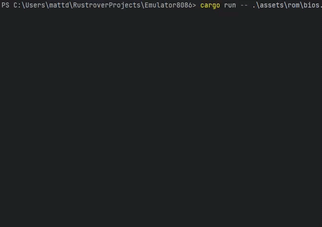

# Emulator8086

A bare-metal Intel 8086 emulator written in Rust that boots real operating systems. It runs MS-DOS, plays DOOM, and renders VGA graphics — all on an emulated 8086 PC with a custom BIOS written in x86 assembly.

## Features

- Boots MS-DOS 6.22, runs real DOS programs and games
- Custom BIOS written in x86 assembly with INT 10h, 13h, 16h, 1Ah services
- Full 8086 instruction set (70+ opcodes) validated against a real Intel P80C86A-2 CPU
- VGA text mode (80x25) with ANSI terminal rendering
- VGA Mode 13h (320x200, 256 colors) with wgpu hardware-accelerated rendering
- Floppy and hard disk support with file-backed or in-memory images
- F12 monitor for swapping disks, copying host files onto them and rebooting the guest at runtime
- Hardware emulation: 8259 PIC, 8253 PIT, XT keyboard (8255 PPI), VGA, DMA, FDC

## Screenshots

### MS-DOS 6.22

Terminal mode (ANSI rendering):


GUI mode (wgpu + winit window):


### F12 Disk Menu (terminal mode)

Installing MS-DOS 6.22 from floppy images with the F12 disk menu:


Copy files to FAT16 drives with the F12 disk menu:


### DOOM (8088 port)

Running DOOM in GUI mode with hardware-accelerated Mode 13h graphics:


## Installation

### Requirements

- [Rust](https://www.rust-lang.org/tools/install) (edition 2021)
- A BIOS ROM (included in `assets/rom/bios.bin`, or build your own with [NASM](https://www.nasm.us/))

### Build

```bash
# Terminal mode (default)
cargo build --release

# GUI mode (wgpu + winit window)
cargo build --release --features gui
```

## Usage

```bash
# Boot from floppy
cargo run --release -- assets/rom/bios.bin --disk a:floppy.img

# Boot from hard disk
cargo run --release -- assets/rom/bios.bin --hd msdos.vhd --boot hd0

# Multiple disks with boot order
cargo run --release -- assets/rom/bios.bin --disk a:dos1.img --hd msdos.vhd --boot a,hd0

# GUI mode (Mode 13h graphics)
cargo run --release --features gui -- assets/rom/bios.bin --hd msdos.vhd --boot hd0
```

### CLI Options

| Option | Description |
|--------|-------------|
| `<ROM>` | Path to BIOS ROM image (required) |
| `--disk <SPEC>` | Floppy disk: `[DRIVE:]SOURCE`, with drive `a`–`d` (default `a`) and source an image file, `memory` or `memory:KB` (e.g. `a:image.img`, `b:memory`). Append `:ro` for read-only. The image for `a:` must exist; for the other drives a missing file is created as a blank 1.44 MB image |
| `--hd <PATH>` | Hard disk image, or `memory` (creates a blank 32 MB image if the file doesn't exist) |
| `--boot <ORDER>` | Boot order: `a,hd0` (default), `hd0,a`, etc. |
| `--trace` | Per-instruction register trace, written to the debug log: run with `RUST_LOG=debug` (and redirect stderr in terminal mode) |

### In-Emulator Controls

| Key | Action |
|-----|--------|
| F12 | Open the monitor (terminal) / dump VGA state to `vga_dump.txt` (GUI) |
| F11 | Dump VGA state to `vga_dump.txt` (terminal) |
| Ctrl+C | Quit (terminal) |

### Monitor Commands (terminal mode, F12)

| Command | Action |
|---------|--------|
| `swap <drive> <image>[:ro]` | Insert an existing disk image |
| `swap <drive> memory[:KB]` | Insert an empty in-memory disk (floppies are formatted) |
| `new <drive> <path>` | Create an image file and insert it |
| `move <from> <to>` | Move a disk between drives |
| `save <drive> <path>` | Save a disk's contents to a file |
| `eject <drive>` | Eject the disk |
| `put <file\|dir> <drive> [name]` | Copy a host file or directory onto a FAT disk |
| `reset` | Reboot the guest |
| `resume` | Resume emulation (or just press Enter) |

Drives are `a`–`d` and `hd0`, `hd1`, …; a path that contains blanks goes in double quotes.

DOS does not notice changes made to a hard disk while it is running: after `put`, `swap`, `eject` or `move` on a hard disk, reboot the guest with `reset`. To copy files without a reboot, go through a floppy (`swap a memory`, `put <file> a`, then `COPY A:<file> C:` in DOS).

### Keyboard Layouts

The GUI sends the physical key positions, like a real keyboard: with a non-US keyboard, load the matching layout in DOS (`KEYB`). The terminal frontend only sees the characters you type, so it presses the keys that produce them on a US keyboard: use it with the guest's default (US) layout.

## Technical Details

### CPU

Full 8086 real-mode with 1MB segmented memory (`segment << 4 + offset`), plus the 80186 additions PUSHA/POPA, PUSH imm, IMUL imm, INS/OUTS, shift/rotate by an immediate count and ENTER/LEAVE (BOUND is accepted and does nothing).

The CPU is not cycle-timed: it runs as fast as the host allows, while the timer chip follows real time.

| Category | Instructions |
|----------|-------------|
| Arithmetic | ADD, ADC, SUB, SBB, INC, DEC, CMP, MUL, IMUL, DIV, IDIV, AAA, AAS, AAD, AAM, DAA, DAS |
| Logic | AND, OR, XOR, NOT, NEG, TEST |
| Shifts/Rotates | ROL, ROR, RCL, RCR, SHL/SAL, SHR, SAR |
| Data Movement | MOV, XCHG, LEA, LES, LDS, LAHF, SAHF, CBW, CWD, XLAT |
| String Ops | MOVS, LODS, STOS, CMPS, SCAS (with REP/REPE/REPNE) |
| Control Flow | JMP, CALL, RET, RETF, IRET, Jcc (all conditions), JCXZ, LOOP, LOOPE, LOOPNE |
| Stack | PUSH, POP, PUSHF, POPF |
| I/O | IN, OUT (byte/word, immediate/DX) |
| Misc | NOP, HLT, WAIT, ESC, LOCK, INT, INT 3, INTO, CLI, STI, CLC, STC, CLD, STD, CMC |

### Emulated Hardware

| Device | Description |
|--------|-------------|
| 8259A PIC | Programmable Interrupt Controller — IRQ masking, ICW init, EOI, ISR/IRR |
| 8253 PIT | Programmable Interval Timer — 3 channels (system timer, DRAM refresh, speaker) |
| XT Keyboard (8255 PPI) | Scancode latch with acknowledge and reset through port 61h, speaker gate, status port |
| VGA | Text mode 80x25 (B8000h) + Mode 13h 320x200x256 (A0000h), CRTC, DAC, Sequencer, Attribute Controller, Graphics Controller |
| 8237A DMA | 4-channel DMA controller (register-level) |
| FDC (uPD765) | Stub — digital output register and an idle status only; disk I/O goes through the BIOS |
| HDC (Xebec) | Stub — status/config registers |
| Disk I/O | Floppy (160 KB to 2.88 MB) and hard disk images, CHS geometry, change line, file-backed or in-memory |

### BIOS Interrupts

| Interrupt | Service |
|-----------|---------|
| INT 08h | Timer tick (IRQ0) — BDA counters, motor timeout, user hook (INT 1Ch) |
| INT 09h | Keyboard (IRQ1) — scancode decoding, modifier tracking, buffer management, Ctrl-Break, Ctrl-Alt-Del |
| INT 10h | Video — set mode (80x25 text + 13h, with palette load), cursor and page control, scroll, read/write char, teletype, get mode, write string, DAC and blink functions, Mode 13h pixels |
| INT 11h | Equipment list |
| INT 12h | Conventional memory size (640 KB) |
| INT 13h | Disk I/O — read/write/verify sectors, format track, drive parameters, disk type and change line, reset, LBA extensions |
| INT 15h | System services — extended memory size query |
| INT 16h | Keyboard — read key, check buffer, shift flags, enhanced keyboard (AH=10h-12h) |
| INT 19h | Bootstrap loader |
| INT 1Ah | Time — read/set system timer ticks |

### What's Not Supported

- **Protected mode / 286+ instructions** — real mode only, 8086 plus the 80186 additions listed above
- **VGA Mode X/Y** — unchained planar modes (only chain-4 Mode 13h)
- **EGA/CGA graphics modes, 40-column text** — only 80x25 text mode and Mode 13h
- **Real-time clock** — DOS starts at 1980-01-01
- **Sound** — no Sound Blaster, PC speaker, or AdLib emulation
- **Serial/parallel ports** — COM and LPT not implemented
- **Mouse** — no mouse driver support
- **Networking** — no packet driver or NE2000

### Testing

The CPU is validated against 608,000 single-instruction test vectors (2,000 per file) captured from a real Intel P80C86A-2 processor. The opcodes that are given their 80186 meaning (60–62, 64–6F, C0, C1, C8, C9) are outside that set. The BIOS and the devices are covered by tests that boot the real ROM on a fully wired machine.

```bash
# Fetch the CPU test vectors (git submodule)
git submodule update --init

# Unit and integration tests
cargo test

# Everything, including the hardware-captured CPU vectors
cargo test --release -- --include-ignored

# Test a single opcode
cargo test cpu_tests::test_opcode_00 -- --ignored

# Tests of the GUI-only code
cargo test --features gui
```

## Credits

- [DOOM 8088](https://github.com/FrenkelS/Doom8088) by Frenkel Smeijers — DOOM port for 8088/8086
- CPU test vectors from [SingleStepTests/8086](https://github.com/SingleStepTests/8086) captured on real P80C86A-2 hardware

## License

This project is licensed under the [MIT License](LICENSE).

You are free to use, copy, modify, merge, publish, distribute, sublicense, and/or sell copies of this software.
